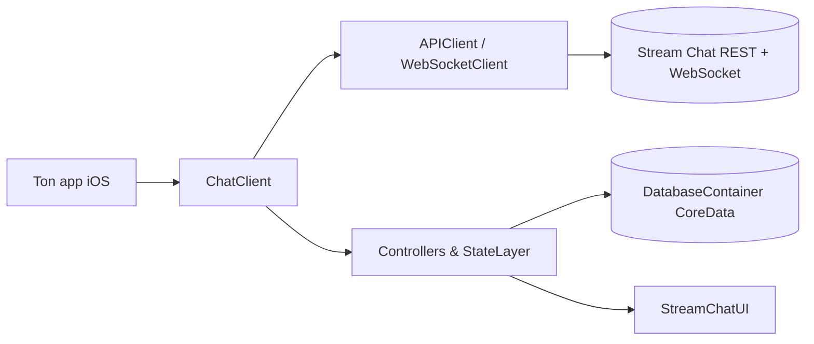

# GetStream/stream-chat-swift

> Official iOS SDK for Stream Chat: a low-level client and UIKit components to add messaging to an app.

## The problem
Building real-time messaging (channels, reactions, threads, offline mode) on iOS means months of work on networking, local storage and interface.

## What it actually does
Provides a low-level client (`StreamChat`) with no interface, and UIKit components (`StreamChatUI`): channel list, message list, composer, polls, voice messages, commands. It talks to Stream's REST API and WebSocket, persists with CoreData and manages an offline queue. The SwiftUI SDK lives in another repository.

## How it is wired

## Trying it
The README documents no command: installation goes through Swift Package Manager (Package.swift) or CocoaPods, and a Stream API key is required.

## Cost and gotchas
A Stream account and an API key are required; free below five team members and $10,000 of monthly revenue, paid beyond that. The backend is proprietary: the SDK does not work without it.

## What it is not
It is not a free or self-hostable chat server. The license is "present but unidentified" according to GitHub. The AI components mentioned are interfaces, not models.

## Alternatives
- StreamChatSwiftUI: the SwiftUI SDK, in another repository.

## For you
Ignore: a mobile SDK tied to a paid SaaS, unrelated to a data/AI/MLOps profile apart from the agent interface components.
