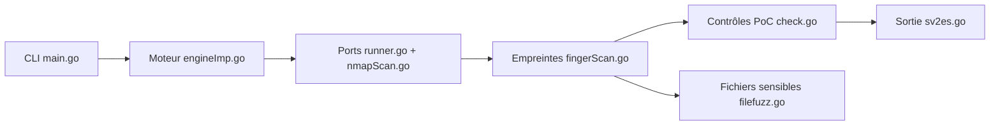

# GhostTroops/scan4all

> Go security scanner that chains ports, web fingerprints and vulnerability checks, for authorized auditors.

## The problem
An attack-surface audit forces you to chain several tools by hand (port discovery, HTTP fingerprints, vulnerability templates) and then gather the results.

## What it actually does
It integrates existing building blocks (nuclei, subfinder, naabu, nmap, httpx) and in-house PoCs. The flow: port discovery, HTTP probing and fingerprinting, web and vulnerability checks, dictionary-based service audit, then report. Results can be sent to Elasticsearch. Several branches (smuggling, crawler, log4j) are described in the README, but their wiring was not verified in the code.

## How it is wired


## Trying it
```bash
go install github.com/GhostTroops/scan4all@2.8.9
scan4all -h
UrlPrecise=true ./scan4all -l xx.txt
```
Only run this against targets you have written authorization for.

## Cost and gotchas
Free. Nmap must be installed yourself (root password passed through an environment variable), Elasticsearch optional via Docker. The README mixes configuration and environment-variable parameters, and is poorly structured.

## What it is not
Not an actively maintained product: last push in July 2024. Not a tool to run without a legal framework: it includes credential tests. The "Work Plan" list remains a plan, not delivered features.

## Alternatives
- nuclei, subfinder, naabu, httpx: the original building blocks, more focused and maintained by their teams.
- nmap alone: if only port discovery matters.

## For you
Watch only: outside the scope of a data/AI/MLOps profile, and a low-activity repo; better to use the original building blocks if an authorized audit is needed.
