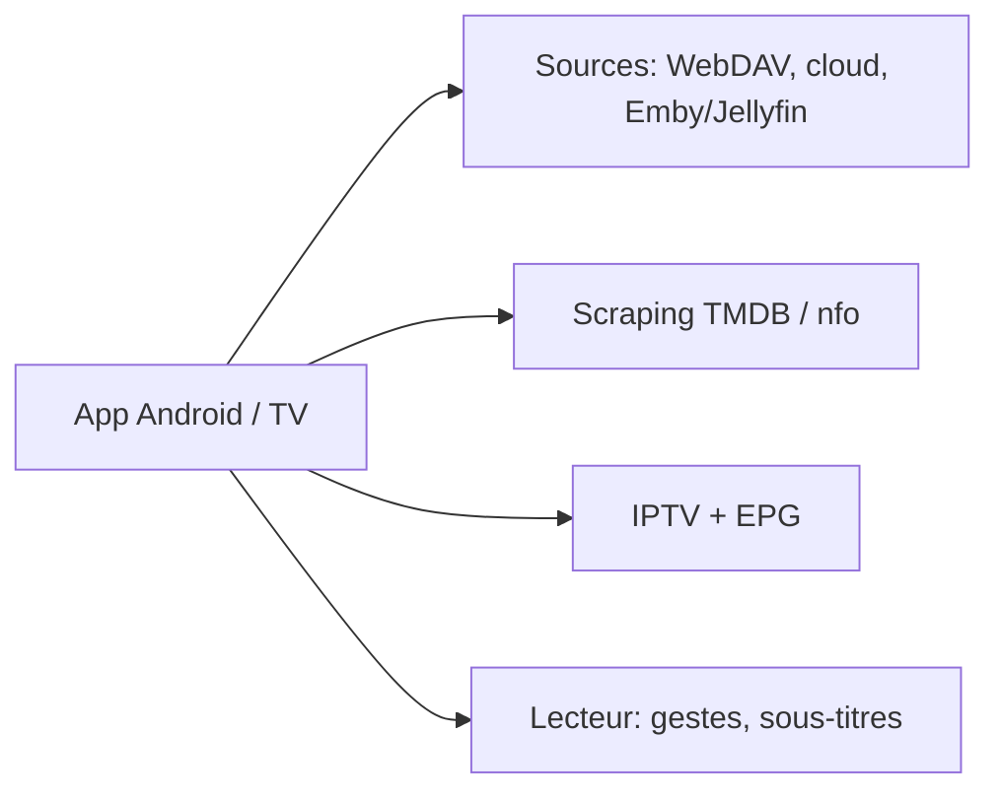

# GhostenEditor/Ghosten-Player

> Android video player (phone and TV) with metadata scraping, IPTV and playback from cloud drives.

## The problem
Organizing a personal media library on Android TV without a dedicated server.

## What it actually does
Scrapes metadata (TMDB, nfo), plays from Aliyun Drive, Quark, WebDAV, local files, Emby and Jellyfin; handles IPTV with EPG, gestures, subtitles, DLNA. Runs locally without a backend (about 15 MB). Android 6+; Windows and macOS versions in development. README in Chinese.

## How it is wired

## Trying it
No command: download the APK matching your architecture from the Releases (phone or TV, separate packages since v1.6.0).

## Cost and gotchas
Free; sponsorship requested. Cloud drive services are the responsibility of their providers; the README warns of account ban risks and rate limiting.

## What it is not
Provides no content. Not a media server: it plays existing sources.

## Alternatives
Emby and Jellyfin (supported as sources, not replacements).

## For you
To ignore: leisure Android application, outside the data/AI/MLOps scope.
