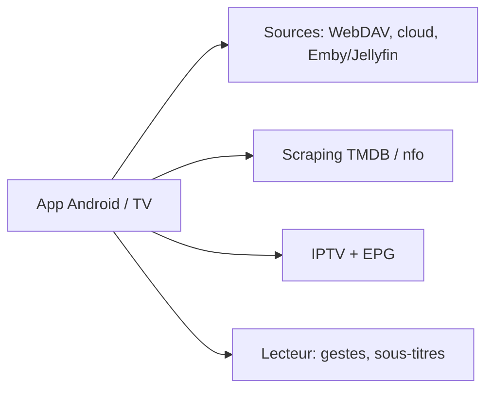

# GhostenEditor/Ghosten-Player

> Lecteur vidéo Android (téléphone et TV) avec scraping de métadonnées, IPTV et lecture depuis des disques cloud.

## Le problème
Organiser une médiathèque personnelle sur Android TV sans serveur dédié.

## Ce que ça fait vraiment
Scrape les métadonnées (TMDB, nfo), lit depuis Aliyun Drive, Quark, WebDAV, fichiers locaux, Emby et Jellyfin ; gère l'IPTV avec EPG, les gestes, les sous-titres, DLNA. Fonctionne en local sans backend (15 Mo environ). Android 6+ ; versions Windows et macOS en développement. README en chinois.

## Comment c'est branché

## Essayer
Aucune commande : télécharger l'APK adapté à l'architecture dans les Releases (téléphone ou TV, paquets séparés depuis la v1.6.0).

## Coût et pièges
Gratuit ; sponsoring demandé. Les services de disque cloud relèvent de leurs fournisseurs ; le README prévient de risques de bannissement de compte et de limitation de débit.

## Ce que ce n'est pas
Ne fournit aucun contenu. Pas un serveur multimédia : il lit des sources existantes.

## Alternatives
Emby et Jellyfin (pris en charge comme sources, pas des remplaçants).

## Pour toi
À ignorer : application de loisir Android, hors périmètre data/IA/MLOps.

