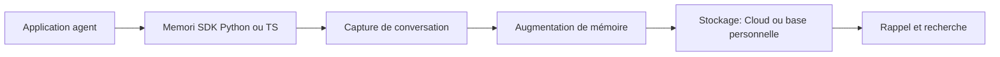

# GibsonAI/Memori

> Memory SDK for agents: captures LLM exchanges, structures them and recalls them later.

## The problem
An agent forgets everything between two sessions and you have to repeat context and preferences.

## What it actually does
The SDK (Python and TypeScript) registers on an LLM client; conversations, attached to an entity (the user) and a process (the agent), are persisted and then recalled automatically. Background augmentation extracts facts, preferences, rules, skills and relationships. OpenClaw and Hermes plugins, MCP access for Claude Code and Cursor, personal database option.

## How it is wired


## Trying it
```bash
pip install memori
python -m memori quota
claude mcp add --transport http memori https://api.memorilabs.ai/mcp/ --header "X-Memori-API-Key: ${MEMORI_API_KEY}"
```

## Cost and gotchas
`MEMORI_API_KEY` is required; advanced augmentation is free for developers but limited without an account. Without attribution (entity and process), no memory is created. An Enterprise offer exists.

## What it is not
It is not local by default: Cloud mode sends conversations to the service. The benchmark figures (LoCoMo) come from the vendor.

## Alternatives
- Zep, LangMem, Mem0: memory systems compared by the README.

## For you
Worth watching: agent memory that is simple to plug in, but your conversations transit through a SaaS and the license is not declared.
