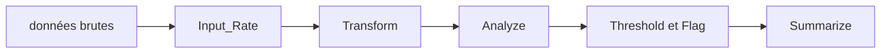

# Gilead-BioStats/gsm

> R package for statistical monitoring of quality risk in clinical trials, replaced by four packages since March 2025.

## The problem
Detect early the clinical trial sites whose data deviate from the others (adverse events, deviations, queries).

## What it actually does
Provides twelve risk assessments (rates of adverse events, deviations, discontinuations, queries...) following a six-step pipeline: Input_Rate, Transform, Analyze, Threshold, Flag, Summarize. Produces RMarkdown and HTML reports. The README states that it is no longer maintained: its functions are split across gsm.core, gsm.mapping, gsm.kri and gsm.reporting.

## How it is wired

## Trying it
No command documented in the README.

## Cost and gotchas
R required. The project is no longer maintained: a move to the successor packages is needed. No installation command is given.

## What it is not
It is not the package to use today: it has been replaced. It is not a general-purpose data quality tool.

## Alternatives
- gsm.core: analytics and workflow utilities.
- gsm.mapping: source data transformations.
- gsm.kri: metrics and visualization.
- The catalog does not flag it as archived; the repository is declared unmaintained by its README.

## For you
Ignore: package declared unmaintained and specialized in clinical trials; if the topic interests you, start from the successor packages.
