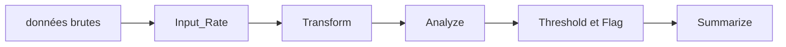

# Gilead-BioStats/gsm

> Package R de suivi statistique du risque qualité dans les essais cliniques, remplacé par quatre paquets depuis mars 2025.

## Le problème
Détecter tôt les centres d'un essai clinique dont les données s'écartent des autres (événements indésirables, déviations, requêtes).

## Ce que ça fait vraiment
Fournit douze évaluations de risque (taux d'événements indésirables, de déviations, d'arrêts, de requêtes...) selon un pipeline en six étapes : Input_Rate, Transform, Analyze, Threshold, Flag, Summarize. Produit des rapports RMarkdown et HTML. Le README annonce qu'il n'est plus maintenu : ses fonctions sont réparties dans gsm.core, gsm.mapping, gsm.kri et gsm.reporting.

## Comment c'est branché

## Essayer
Aucune commande documentée dans le README.

## Coût et pièges
R requis. Le projet n'est plus maintenu : un pas vers les paquets successeurs est nécessaire. Aucune commande d'installation n'est donnée.

## Ce que ce n'est pas
Ce n'est pas le paquet à utiliser aujourd'hui : il est remplacé. Ce n'est pas un outil généraliste de qualité des données.

## Alternatives
- gsm.core : analytique et utilitaires de workflows.
- gsm.mapping : transformations des données sources.
- gsm.kri : métriques et visualisation.
- Le catalogue ne signale pas d'archivage ; le dépôt est déclaré non maintenu par son README.

## Pour toi
À ignorer : paquet déclaré non maintenu et spécialisé dans les essais cliniques ; si le sujet t'intéresse, pars des paquets successeurs.

