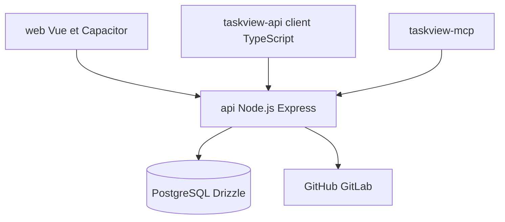

# Gimanh/taskview-community

> Self-hosted project management for software teams, with an MCP server for AI assistants.

## The problem
Enterprise project management tools are heavy, and simple tools lack structure and developer integrations.

## What it actually does
Projects, tasks, subtasks, Kanban boards, dependencies, sprints, time and finance tracking. GitHub, GitLab, signed webhooks, SAML, OIDC, SCIM integrations. The `taskview-mcp` server lets an assistant read and modify tasks according to the token's rights.

## How it is wired


## Trying it
```json
{
  "mcpServers": {
    "taskview": {
      "command": "npx",
      "args": ["-y", "taskview-mcp"],
      "env": {"TASKVIEW_URL": "https://api.taskview.tech", "TASKVIEW_TOKEN": "tvk_your_token_here"}
    }
  }
}
```
Recommended deployment: Docker Compose, details in the official documentation.

## Cost and gotchas
Free when self-hosted. You need Docker and PostgreSQL, HTTPS and backups. Migrations and breaking changes are possible between versions. Limit the MCP token's rights.

## What it is not
Not open source: source-available license, not recognized by GitHub. Offering the software as SaaS or building a competing commercial product is forbidden.

## Alternatives
No alternative named in the README.

## For you
Worth watching: the MCP integration is interesting for agents, but the restrictive license and the single maintainer limit team use.
