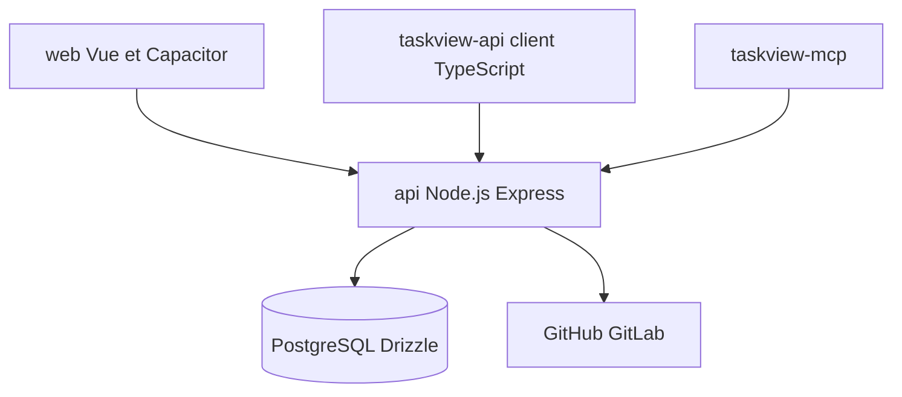

# Gimanh/taskview-community

> Gestion de projet auto-hébergée pour équipes logicielles, avec serveur MCP pour assistants IA.

## Le problème
Les outils de gestion de projet d'entreprise sont lourds, et les outils simples manquent de structure et d'intégrations de développement.

## Ce que ça fait vraiment
Projets, tâches, sous-tâches, tableaux Kanban, dépendances, sprints, suivi du temps et des finances. Intégrations GitHub, GitLab, webhooks signés, SAML, OIDC, SCIM. Le serveur `taskview-mcp` laisse un assistant lire et modifier les tâches selon les droits du jeton.

## Comment c'est branché


## Essayer
```json
{
  "mcpServers": {
    "taskview": {
      "command": "npx",
      "args": ["-y", "taskview-mcp"],
      "env": {"TASKVIEW_URL": "https://api.taskview.tech", "TASKVIEW_TOKEN": "tvk_your_token_here"}
    }
  }
}
```
Déploiement recommandé : Docker Compose, détails dans la documentation officielle.

## Coût et pièges
Gratuit en auto-hébergement. Il faut Docker et PostgreSQL, HTTPS et sauvegardes. Des migrations et changements cassants sont possibles entre versions. Limiter les droits du jeton MCP.

## Ce que ce n'est pas
Pas open source : licence source-available, non reconnue par GitHub. Interdit de proposer le logiciel en SaaS ou de créer un produit commercial concurrent.

## Alternatives
Aucune alternative nommée dans le README.

## Pour toi
À surveiller : l'intégration MCP est intéressante pour agents, mais la licence restrictive et le mainteneur unique limitent un usage en équipe.

