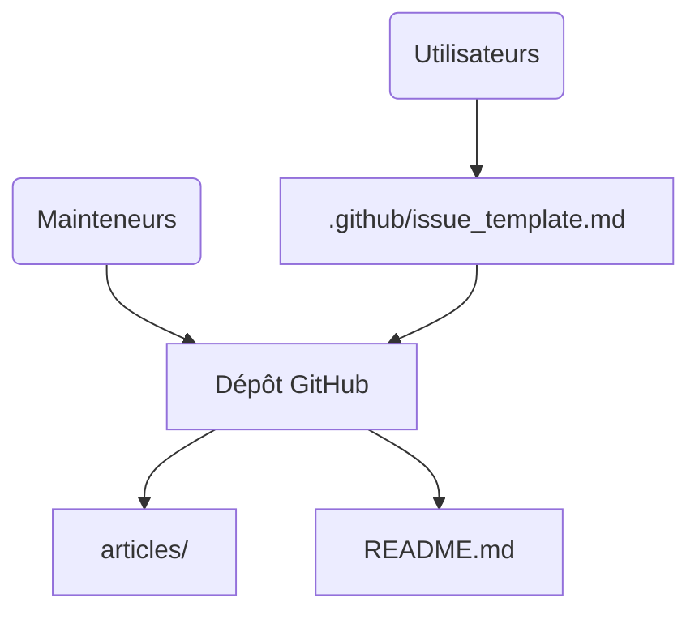

# GitHubDaily/GitHubDaily

> Annual list, in Chinese, of open-source projects recommended by the GitHubDaily channel.

## The problem
The volume of new deposits is too large to be effectively monitored; a curated selection is required.

## What it actually does
The README is a 2025-dated inventory, categorized by type (AI tools, tutorials, practical tools, plugins, media, languages, services), with a description for each project. The majority of the entries in the "read" section relate to AI: agents, MCP, OCR, RAG, and generation. The README is truncated in the source; the other categories have not been reviewed. Previous inventories (2018-2024) are linked.

## How it is wired

## Trying it
No instructions: please read the README. To propose a project, open an issue.

## Cost and gotchas
Free. Text in Chinese. The provided diagram assumes a static website and GitHub Actions, with no evidence of this in the README.

## What it is not
Neither a ranked list nor a tool. No license is declared. Descriptions are not verified individually.

## Alternatives
No alternative is specified in the README file.

## For you
Sources of ideas for monitoring if you read Chinese; keep it as a discovery stream and verify each project yourself.
