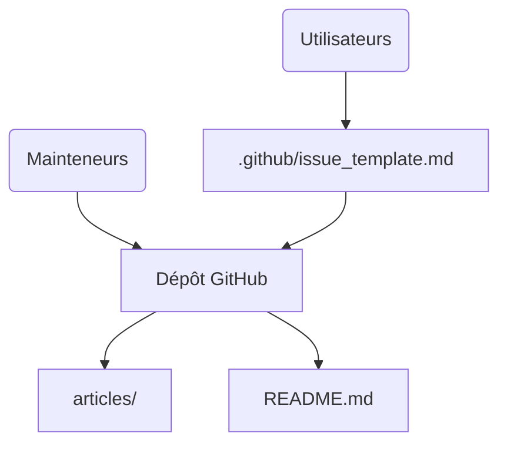

# GitHubDaily/GitHubDaily

> Liste annuelle, en chinois, de projets open source recommandés par la chaîne GitHubDaily.

## Le problème
Le volume de nouveaux dépôts est trop grand pour être suivi ; il faut une sélection commentée.

## Ce que ça fait vraiment
Le README est un bilan de 2025 classé par catégories (outils IA, tutoriels, outils pratiques, plugins, médias, langages, services), avec une description d'une ligne par projet. Sur la partie lue, la majorité des entrées concerne l'IA : agents, MCP, OCR, RAG, génération. Le README est tronqué dans la source ; les autres catégories n'ont pas été lues. Les anciens bilans (2018 à 2024) sont liés.

## Comment c'est branché

## Essayer
Aucune commande : lire le README. Pour proposer un projet, ouvrir une issue.

## Coût et pièges
Gratuit. Texte en chinois. Le diagramme fourni suppose un site statique et GitHub Actions sans preuve dans le README.

## Ce que ce n'est pas
Ni un classement évalué ni un outil. Aucune licence déclarée. Les descriptions ne sont pas vérifiées une à une.

## Alternatives
Aucune alternative nommée dans le README.

## Pour toi
Source d'idées pour la veille si tu lis le chinois ; garde-la comme flux de découverte et vérifie chaque projet toi-même.

