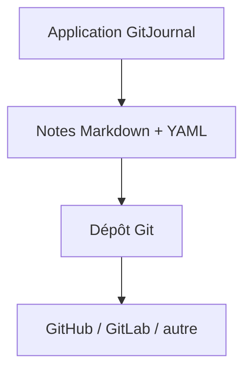

# GitJournal/GitJournal

> Mobile note-taking app that stores everything as Markdown in a Git repository of your choice.

## The problem
Note-taking apps lock your data into their own format and cloud.

## What it actually does
Notes are stored as Markdown, with an optional YAML header, in a Git repository (GitHub, GitLab or another provider). You can therefore self-host. The README mentions import from Google Keep, Day One Classic, Narrate and Simplenote. Nothing else is documented.

## How it is wired
Simplified diagram based on the fiche, no diagram provided.

## Trying it
No command documented in the README: installation is not documented.

## Cost and gotchas
Free on the code side; you need an account with a Git host. AGPL-3.0 license.

## What it is not
It is not a data or AI tool. The README is too short to judge synchronization or encryption.

## Alternatives
No alternative named in the README.

## For you
Ignore: a personal note-taking app, unrelated to your work, and the README material is thin.
