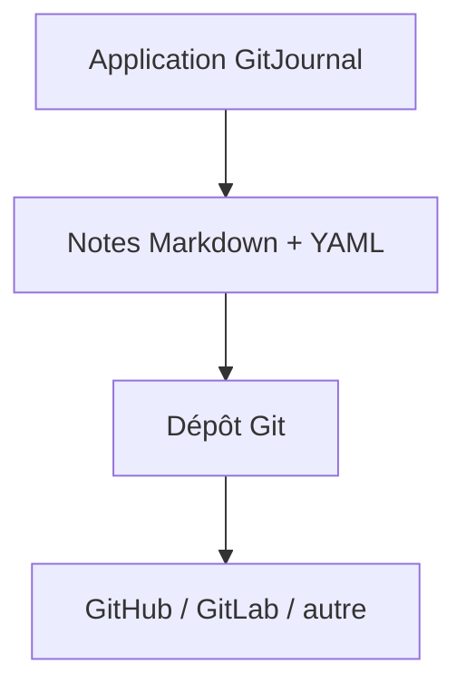

# GitJournal/GitJournal

> Application de notes mobile qui range tout en Markdown dans un dépôt Git de ton choix.

## Le problème
Les applications de notes enferment les données dans leur format et leur cloud.

## Ce que ça fait vraiment
Les notes sont stockées en Markdown, avec un en-tête YAML facultatif, dans un dépôt Git (GitHub, GitLab ou autre fournisseur). On peut donc héberger soi-même. Le README cite l'import depuis Google Keep, Day One Classic, Narrate et Simplenote. Rien d'autre n'est documenté.

## Comment c'est branché
Schéma simplifié d'après la fiche, sans diagramme fourni.

## Essayer
Aucune commande documentée dans le README : installation non documentée.

## Coût et pièges
Gratuit côté code ; il faut un compte chez un hébergeur Git. Licence AGPL-3.0.

## Ce que ce n'est pas
Ce n'est pas un outil de données ni d'IA. Le README est trop court pour juger de la synchronisation ou du chiffrement.

## Alternatives
Aucune alternative nommée dans le README.

## Pour toi
Ignorer : application de notes personnelle, sans lien avec ton métier, et la matière du README est mince.

