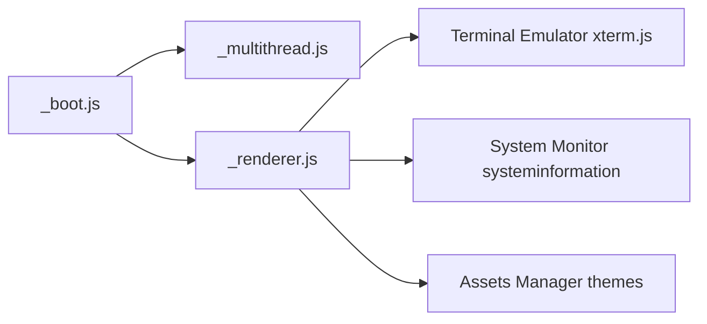

# GitSquared/edex-ui

> Fullscreen sci-fi-looking terminal emulator with a system monitor, for enthusiasts.

## The problem
No real problem: it is an aesthetic terminal inspired by TRON Legacy.

## What it actually does
Tabbed terminal (xterm.js), real-time CPU/RAM/network monitoring (systeminformation), a file browser that follows the current directory (except on Windows), touch keyboard, themes and sounds. Electron application: `_boot.js` starts it, `_multithread.js` delegates, `_renderer.js` draws.

## How it is wired


## Trying it
```bash
npm run install-linux
npm run start
npm run build-linux
```

## Cost and gotchas
Unsigned binaries. Project archived since 2021: no fixes.

## What it is not
Not a maintained working terminal; the author himself says it is "maybe a joke taken too seriously".

## Alternatives
None named in the README.

## For you
Visual curiosity, of no data/AI interest: ignore.
