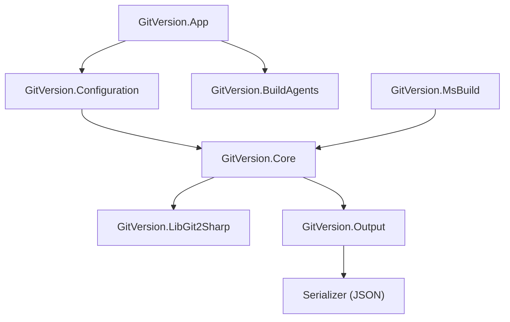

# GitTools/GitVersion

> Computes the semantic version of a commit from Git history, to automate versioning in CI.

## The problem
Numbering versions by hand quickly drifts; you need a version derived from history, branches and tags.

## What it actually does
Reads Git history, applies versioning and branching strategies, then writes the result to the console, JSON, AssemblyInfo, project files or Wix. It detects the build agent (GitHub Actions, Azure Pipelines…). It is consumed as a .NET tool, MSBuild task, GitHub action, Azure task, Docker image, Homebrew, Chocolatey or Winget.

## How it is wired

## Trying it
No command documented in the README: details are on the documentation site; the repository lists the installation channels (NuGet, Homebrew, Chocolatey, Winget, Docker).

## Cost and gotchas
Free. Sampled telemetry is possible during campaigns enabled by the maintainers, with opt-out described in the dedicated policy.

## What it is not
Not a full release tool: it computes a version number, it does not publish. It assumes a clean Git history and branch conventions.

## Alternatives
No alternative cited in the README.

## For you
Watch: relevant for automatically versioning model packages in CI, but written for the .NET ecosystem.
