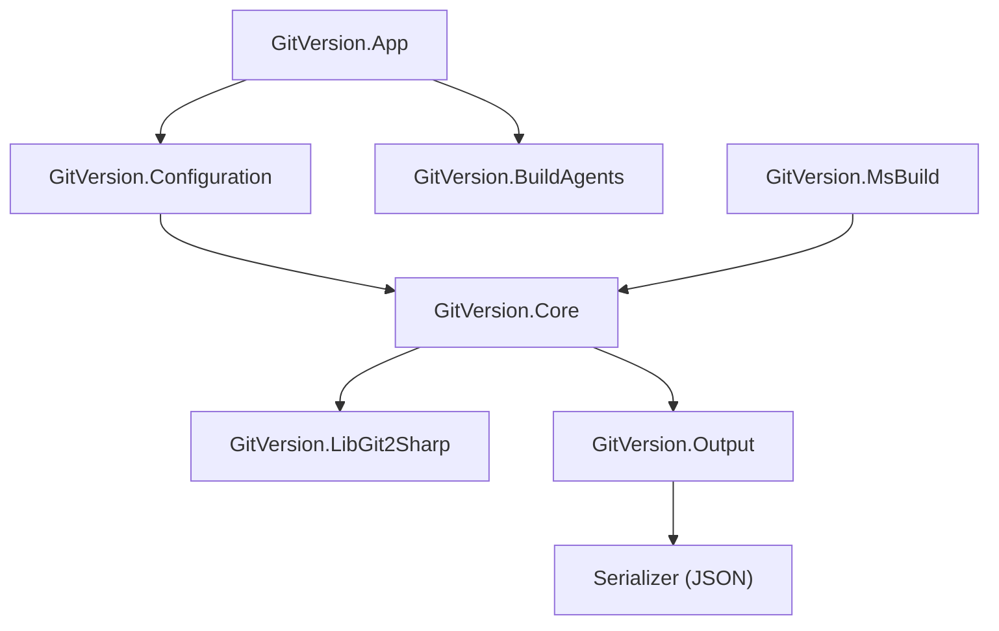

# GitTools/GitVersion

> Calcule la version sémantique d'un commit à partir de l'historique Git, pour automatiser le versionnage en CI.

## Le problème
Numéroter les versions à la main dérive vite ; il faut une version déduite de l'historique, des branches et des tags.

## Ce que ça fait vraiment
Lit l'historique Git, applique des stratégies de version et de branche, puis écrit le résultat en console, en JSON, en AssemblyInfo, dans des fichiers de projet ou Wix. Il détecte l'agent de build (GitHub Actions, Azure Pipelines…). Il se consomme comme outil .NET, tâche MSBuild, action GitHub, tâche Azure, image Docker, Homebrew, Chocolatey ou Winget.

## Comment c'est branché

## Essayer
Aucune commande documentée dans le README : le détail est sur le site de documentation ; le dépôt liste les canaux d'installation (NuGet, Homebrew, Chocolatey, Winget, Docker).

## Coût et pièges
Gratuit. Télémétrie échantillonnée possible pendant des campagnes activées par les mainteneurs, avec désactivation décrite dans la politique dédiée.

## Ce que ce n'est pas
Pas un outil de release complet : il calcule un numéro de version, il ne publie pas. Il suppose un historique Git propre et des conventions de branches.

## Alternatives
Aucune alternative citée dans le README.

## Pour toi
Surveiller : pertinent pour versionner automatiquement des paquets de modèles en CI, mais écrit pour l'écosystème .NET.

