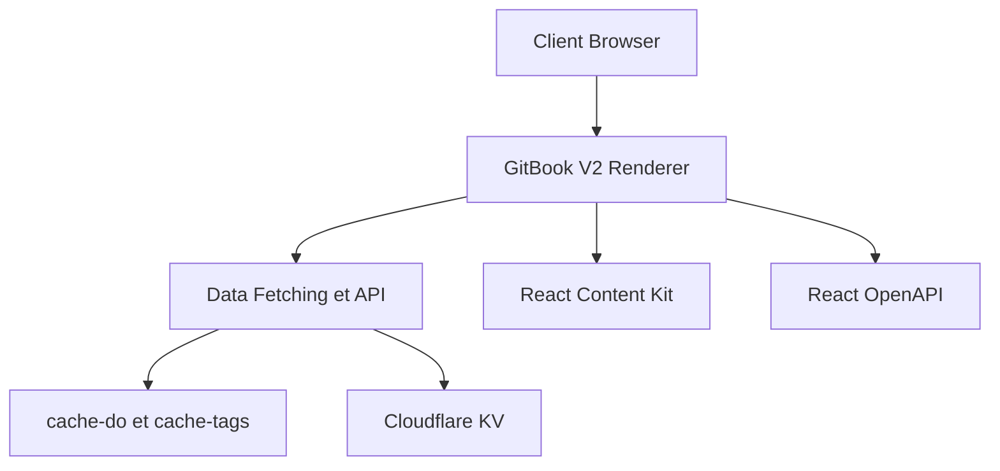

# GitbookIO/gitbook

> Open source rendering engine for documentation sites published on GitBook, for those who want to self-host.

## The problem
Displaying documentation written on GitBook inside your own application, with your own style.

## What it actually does
Next.js monorepo (run with Bun) that renders the published content of a GitBook space. A published site is opened via `localhost:3000/url/...`. It includes caching (cache-do, cache-tags, Cloudflare KV), React components (contentkit, math, OpenAPI), an OpenAPI parser, icons and Cloudflare and Vercel deployment workflows.

## How it is wired



## Trying it
```bash
git clone https://github.com/gitbookIO/gitbook.git
nvm use
bun install
bun dev
```

## Cost and gotchas
Node >= 22.3 and Bun >= 1.2.15. GPLv3 license: a private repository requires a commercial license. Content comes from the GitBook platform, so it remains necessary. Self-hosting is not recommended: maintenance and updates are on you.

## What it is not
It is not GitBook's editor nor the old CLI tool (deprecated). It is not a standalone site generator: it renders content published elsewhere.

## Alternatives
No alternative named in the README.

## For you
Ignore: depends on the GitBook platform and a restrictive license; to document a data project, a standalone docs tool is simpler.
