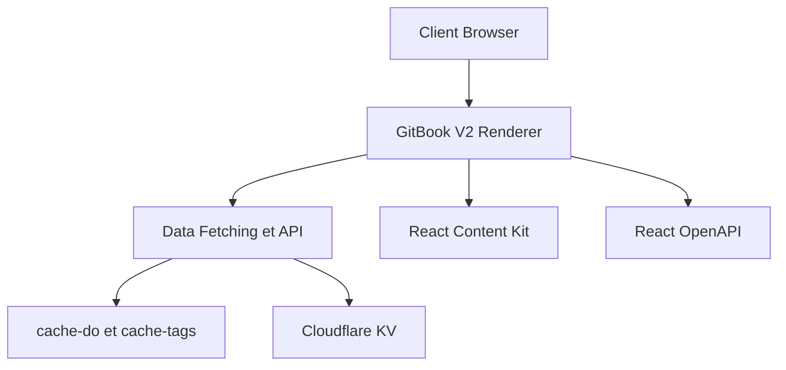

# GitbookIO/gitbook

> Moteur de rendu open source des sites de documentation publiés sur GitBook, pour qui veut l'auto-héberger.

## Le problème
Afficher dans sa propre application une documentation écrite sur GitBook, avec son propre style.

## Ce que ça fait vraiment
Monorepo Next.js (exécuté avec Bun) qui rend le contenu publié d'un espace GitBook. On ouvre un site publié via `localhost:3000/url/...`. Il comprend le cache (cache-do, cache-tags, Cloudflare KV), des composants React (contentkit, math, OpenAPI), un parseur OpenAPI, des icônes et des workflows de déploiement Cloudflare et Vercel.

## Comment c'est branché



## Essayer
```bash
git clone https://github.com/gitbookIO/gitbook.git
nvm use
bun install
bun dev
```

## Coût et pièges
Node >= 22.3 et Bun >= 1.2.15. Licence GPLv3 : un dépôt privé exige une licence commerciale. Le contenu vient de la plateforme GitBook, donc elle reste nécessaire. L'auto-hébergement n'est pas recommandé : maintenance et mises à jour à ta charge.

## Ce que ce n'est pas
Ce n'est pas l'éditeur de GitBook ni l'ancien outil CLI (déprécié). Ce n'est pas un générateur de site autonome : il rend du contenu publié ailleurs.

## Alternatives
Aucune alternative nommée dans le README.

## Pour toi
À ignorer : dépend de la plateforme GitBook et d'une licence contraignante ; pour documenter un projet data, un outil de docs autonome est plus simple.

