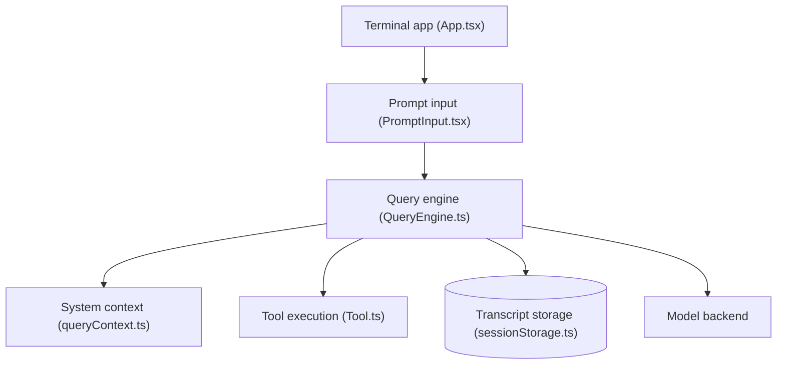

# Gitlawb/openclaude

> Terminal coding agent that works with cloud or local models, derived from the Claude Code code.

## The problem
Coding agents are tied to a provider; switching model or going local forces you to switch tools.

## What it actually does
A single CLI: prompts, tools (bash, files, grep), agents, tasks, MCP, slash commands, streamed responses. Providers: OpenAI-compatible APIs, Gemini, GitHub Models, Codex, Ollama and others, with profiles saved through `/provider`. Session resume and fork, background sessions, repository map, gRPC server, VS Code extension.

## How it is wired


## Trying it
```bash
npm install -g @twigpine/openclaude@latest
openclaude
export CLAUDE_CODE_USE_OPENAI=1
export OPENAI_BASE_URL=http://localhost:11434/v1
export OPENAI_MODEL=qwen2.5-coder:7b
```

## Cost and gotchas
Node.js 24.22.1 or later. API keys at your expense except for a local Ollama model. The default provider at install time requires a key from gitlawb.com. The fallback web search goes through Exa or DuckDuckGo. The package moved from `@gitlawb/openclaude` to `@twigpine/openclaude`.

## What it is not
Not affiliated with Anthropic, as the README says. Small local models struggle on long tool chains. License present but not identified by GitHub, on code derived from Claude Code: read it before use.

## Alternatives
No alternative named in the README.

## For you
Useful for testing coding agents on Ollama or other providers, but the license is unclear and the repository is the twin of Twigpine/openclaude: worth watching.
