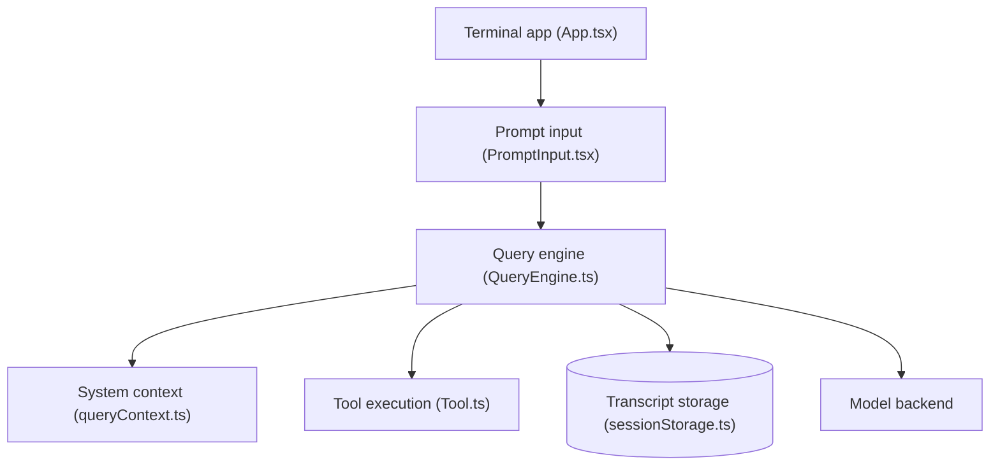

# Gitlawb/openclaude

> Agent de code en terminal qui fonctionne avec des modèles cloud ou locaux, issu du code de Claude Code.

## Le problème
Les agents de code sont liés à un fournisseur ; changer de modèle ou passer en local oblige à changer d'outil.

## Ce que ça fait vraiment
Une CLI unique : prompts, outils (bash, fichiers, grep), agents, tâches, MCP, commandes slash, réponses en flux. Fournisseurs : API compatibles OpenAI, Gemini, GitHub Models, Codex, Ollama et d'autres, avec profils enregistrés via `/provider`. Reprise et bifurcation de sessions, sessions en arrière-plan, carte du dépôt, serveur gRPC, extension VS Code.

## Comment c'est branché


## Essayer
```bash
npm install -g @twigpine/openclaude@latest
openclaude
export CLAUDE_CODE_USE_OPENAI=1
export OPENAI_BASE_URL=http://localhost:11434/v1
export OPENAI_MODEL=qwen2.5-coder:7b
```

## Coût et pièges
Node.js 24.22.1 ou plus. Clés d'API à ta charge sauf modèle Ollama local. Le fournisseur par défaut à l'installation exige une clé auprès de gitlawb.com. La recherche web de repli passe par Exa ou DuckDuckGo. Le paquet est passé de `@gitlawb/openclaude` à `@twigpine/openclaude`.

## Ce que ce n'est pas
Pas affilié à Anthropic, comme le dit le README. Les modèles locaux petits peinent sur les longues chaînes d'outils. Licence présente mais non identifiée par GitHub, sur un code dérivé de Claude Code : à lire avant usage.

## Alternatives
Aucune alternative nommée dans le README.

## Pour toi
Utile pour tester des agents de code sur Ollama ou d'autres fournisseurs, mais la licence est floue et le dépôt est jumeau de Twigpine/openclaude : à surveiller.

