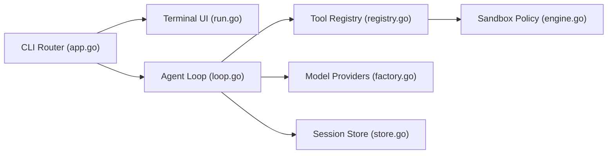

# Gitlawb/zero

> Terminal coding agent, multi-model-provider, with local permissions and sessions.

## The problem
Coding agents lock you into one provider and hide their side effects.

## What it actually does
Go binary with a TUI interface and a scriptable `zero exec` mode (text, JSON, stream-JSON, isolated worktrees). Agent loop with file and shell tools, subject to a permissions and sandbox policy. Providers: OpenAI, Anthropic, Gemini, Ollama, LM Studio and compatible endpoints. Extensible through MCP, skills, plugins, hooks and subagents. Sessions stored on disk, no telemetry announced.

## How it is wired


## Trying it
```bash
npm install -g @gitlawb/zero
zero
zero exec "fix the failing test in ./pkg"
zero doctor
```

## Cost and gotchas
Provider key at your expense (or a local model). Building from source: Go 1.26.6+. On Linux, a sandbox helper must be built separately. 86 open issues.

## What it is not
Not a proven product: the repository dates from May 2026 and the README still mentions testing before the first public release. The absence of telemetry is declarative.

## Alternatives
No alternative named in the README.

## For you
Worth watching: an open coding agent that is interesting if you want to switch models freely, but too young for critical use.
