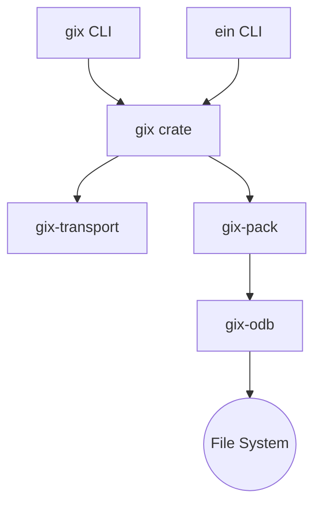

# GitoxideLabs/gitoxide

> Implementation of git in Rust, as a `gix` library and binaries, for tool developers.

## The problem
Existing git libraries (libgit2, GitPython) do not aim at parallel performance or Rust's type safety.

## What it actually does
A set of Rust crates (gix-config, gix-odb, gix-pack, gix-protocol…) behind the `gix` crate. Clone, fetch, status, diff, blame (plumbing) and access to objects, refs and the index are done; push, merge and rebase are not. The `gix` and `ein` binaries are unstable and must not be scripted.

## How it is wired


## Trying it
```bash
cargo binstall gitoxide
brew install gitoxide
cargo install gitoxide --locked --no-default-features --features max-pure
```

## Cost and gotchas
Free. Rust and a C compiler are needed to build; the `max` version also requires `cmake`. The Dockerfile is not continuously tested.

## What it is not
Not a complete replacement for git: push, merge and rebase are missing, and the CLIs may change.

## Alternatives
- GitPython and libgit2: more complete today, the README aims to replace them.

## For you
Worth watching: interesting for Rust tools around git repositories, but incomplete for everyday MLOps use.
