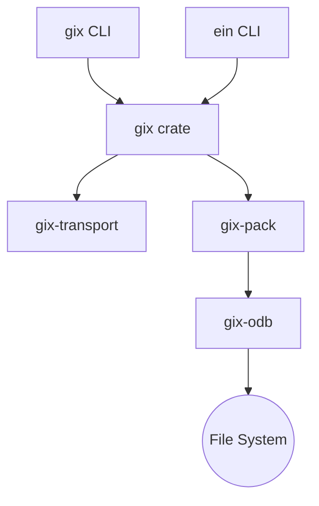

# GitoxideLabs/gitoxide

> Implémentation de git en Rust, sous forme de bibliothèque `gix` et de binaires, pour développeurs d'outils.

## Le problème
Les bibliothèques git existantes (libgit2, GitPython) ne visent pas la performance parallèle ni la sûreté de typage de Rust.

## Ce que ça fait vraiment
Un ensemble de crates Rust (gix-config, gix-odb, gix-pack, gix-protocol…) derrière la crate `gix`. Clone, fetch, status, diff, blame (plomberie) et accès aux objets, refs et index sont faits ; push, merge et rebase ne le sont pas. Les binaires `gix` et `ein` sont instables et ne doivent pas être scriptés.

## Comment c'est branché


## Essayer
```bash
cargo binstall gitoxide
brew install gitoxide
cargo install gitoxide --locked --no-default-features --features max-pure
```

## Coût et pièges
Gratuit. Rust et un compilateur C sont nécessaires pour compiler ; la version `max` demande aussi `cmake`. Le Dockerfile n'est pas testé en continu.

## Ce que ce n'est pas
Pas un remplaçant complet de git : push, merge et rebase manquent, et les CLI peuvent changer.

## Alternatives
- GitPython et libgit2 : plus complets aujourd'hui, le README vise à les remplacer.

## Pour toi
À surveiller : intéressant pour des outils Rust autour de dépôts git, mais incomplet pour un usage MLOps courant.

