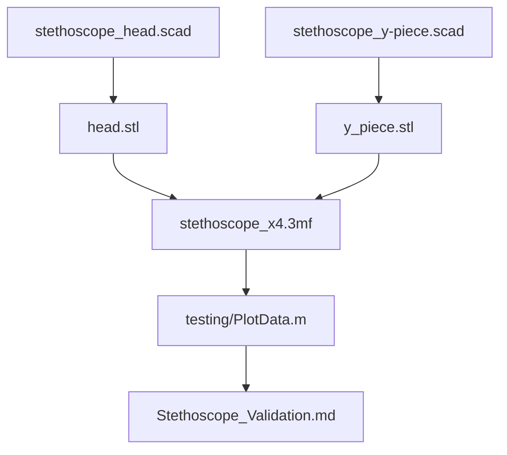

# GliaX/Stethoscope

> Open plans for a 3D-printed stethoscope, validated by publication, for manufacturers and makers.

## The problem
A clinical-grade stethoscope is expensive in resource-limited settings.

## What it actually does
Provides the STL, 3MF and SCAD files, the bill of materials (silicone tubing, 0.35 mm plastic diaphragm, ear tips) and the printing (100% infill, PETG or ABS) and assembly instructions. The text claims performance equivalent to a Littmann Cardiology III, backed by a PLOS ONE publication. According to the code, the OpenSCAD and CrystalSCAD models produce the STL files, grouped into a 3MF; `testing/PlotData.m` analyzes the recordings.

## How it is wired


## Trying it
```shell
gem install crystalscad
ruby source_files/stethoscope_head/stethoscope_head.rb
```

## Cost and gotchas
Hardware: 3D printer, filament, tubing. Infill must be 100% or the sound is wrong. TAPR OHL license "to the extent applicable", not identified by GitHub.

## What it is not
Not a certified medical device: an open project whose validation is published.

## Alternatives
The chestpiece model on youmagine.com, cited in the README.

## For you
Ignore: a medical hardware project with no link to data, AI or MLOps.
