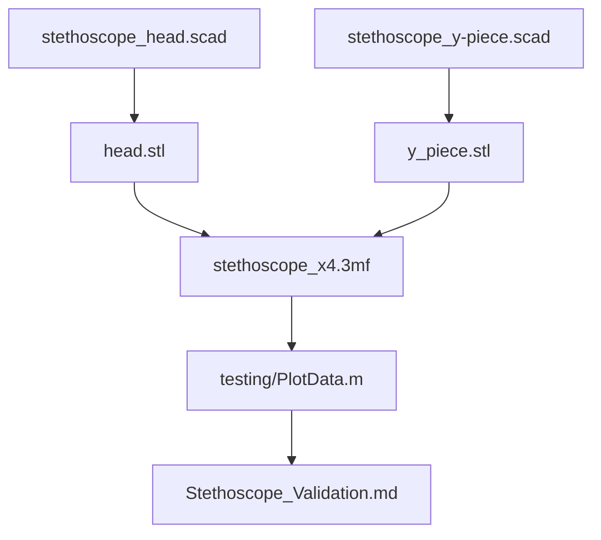

# GliaX/Stethoscope

> Plans libres d'un stéthoscope imprimé en 3D, validé par publication, pour fabricants et makers.

## Le problème
Un stéthoscope de qualité clinique coûte cher dans les contextes à ressources limitées.

## Ce que ça fait vraiment
Fournit les fichiers STL, 3MF et SCAD, la liste du matériel (tubes en silicone, diaphragme en plastique de 0,35 mm, embouts) et les consignes d'impression (remplissage 100 %, PETG ou ABS) et d'assemblage. Le texte revendique des performances équivalentes à un Littmann Cardiology III, avec une publication PLOS ONE. D'après le code, les modèles OpenSCAD et CrystalSCAD produisent les STL, regroupés en 3MF ; `testing/PlotData.m` analyse les enregistrements.

## Comment c'est branché


## Essayer
```shell
gem install crystalscad
ruby source_files/stethoscope_head/stethoscope_head.rb
```

## Coût et pièges
Matériel : imprimante 3D, filament, tubes. Le remplissage doit être à 100 % sinon le son est faux. Licence TAPR OHL « dans la mesure applicable », non identifiée par GitHub.

## Ce que ce n'est pas
Pas un dispositif médical certifié : un projet libre dont la validation est publiée.

## Alternatives
Le modèle de chestpiece sur youmagine.com, cité dans le README.

## Pour toi
À ignorer : projet de matériel médical sans lien avec la data, l'IA ou le MLOps.

