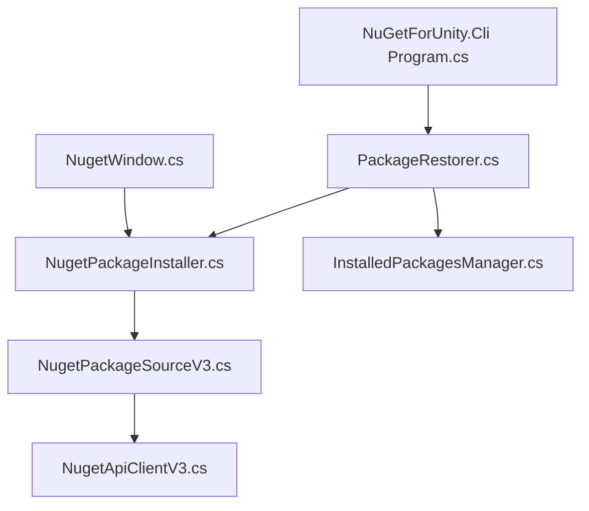

# GlitchEnzo/NuGetForUnity

> NuGet client built into the Unity editor for installing .NET packages, for Unity developers.

## The problem
Unity does not use the standard .NET build: adding NuGet packages and their dependencies to it by hand is painful.

## What it actually does
A window in the editor lists online, installed and upgradable packages, with install, uninstall and upgrade. Packages are declared in `packages.config` and the source in `NuGet.config` (nuget.org by default, private servers possible). A command-line tool, `NuGetForUnity.Cli`, restores packages without launching Unity.

## How it is wired
Diagram based on the one provided.



## Trying it
```bash
openupm add com.github-glitchenzo.nugetforunity
dotnet tool install --global NuGetForUnity.Cli
nugetforunity restore <chemin du projet Unity>
```

## Cost and gotchas
Free. Authentication on some third-party servers is not always supported, and restoring can be slow. Assembly version conflicts sometimes occur.

## What it is not
Not Microsoft's official NuGet client: it was written from scratch and does not cover every case. It does not resolve all package incompatibilities with Mono or IL2CPP.

## Alternatives
No alternative named in the README.

## For you
Ignore: it only serves Unity projects, outside your data/AI/MLOps scope.
