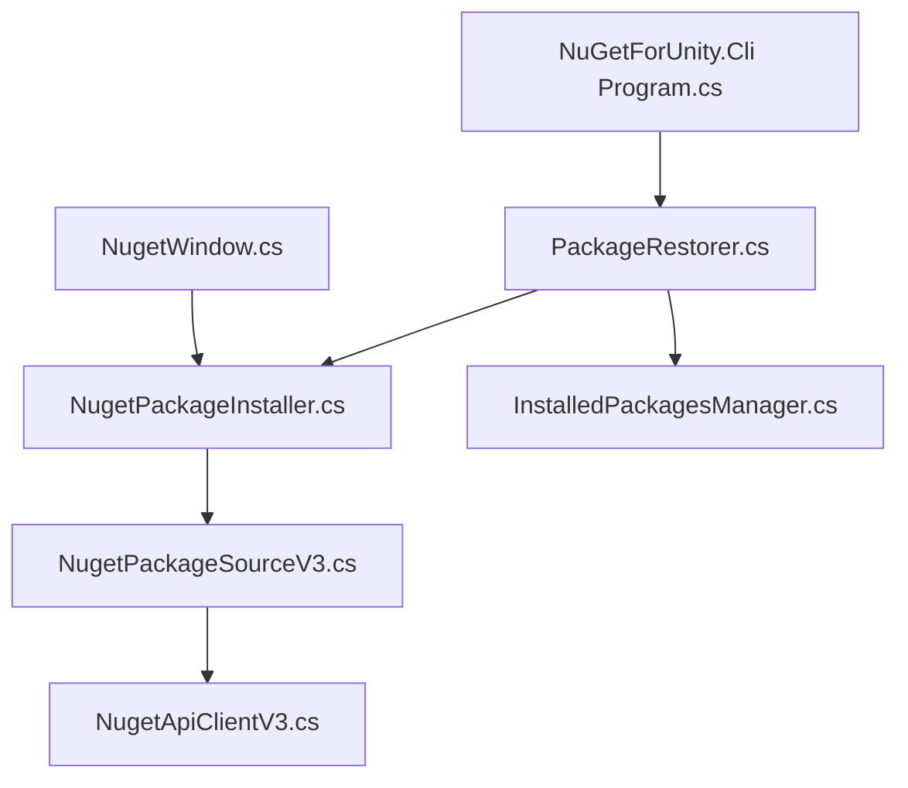

# GlitchEnzo/NuGetForUnity

> Client NuGet intégré à l'éditeur Unity pour installer des paquets .NET, pour développeurs Unity.

## Le problème
Unity n'utilise pas le build .NET standard : y ajouter des paquets NuGet et leurs dépendances à la main est pénible.

## Ce que ça fait vraiment
Une fenêtre dans l'éditeur liste les paquets en ligne, installés et à mettre à jour, avec installation, désinstallation et mises à niveau. Les paquets se déclarent dans `packages.config` et la source dans `NuGet.config` (nuget.org par défaut, serveurs privés possibles). Un outil en ligne de commande, `NuGetForUnity.Cli`, restaure les paquets sans lancer Unity.

## Comment c'est branché
Schéma d'après le diagramme fourni.



## Essayer
```bash
openupm add com.github-glitchenzo.nugetforunity
dotnet tool install --global NuGetForUnity.Cli
nugetforunity restore <chemin du projet Unity>
```

## Coût et pièges
Gratuit. L'authentification sur certains serveurs tiers n'est pas toujours prise en charge, et la restauration peut être longue. Des conflits de versions d'assemblies surviennent parfois.

## Ce que ce n'est pas
Pas le client NuGet officiel de Microsoft : il a été écrit de zéro et ne couvre pas tous les cas. Il ne règle pas toutes les incompatibilités de paquets avec Mono ou IL2CPP.

## Alternatives
Aucune alternative nommée dans le README.

## Pour toi
À ignorer : il ne sert qu'aux projets Unity, hors de ton périmètre data/IA/MLOps.

