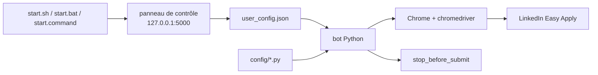

# GodsScion/Auto_job_applier_linkedIn

> Local tool that automates LinkedIn job applications from your own account and your own machine.

## The problem
Applying in bulk on LinkedIn means filling in the same Easy Apply fields a hundred times.
Existing tools require handing your credentials and CV to a third-party service.

## What it actually does
Runs entirely on your machine with your LinkedIn account: finds relevant job offers,
fills in the application questions — with optional AI help — and applies with the CV you provide.
The README claims 100+ applications in under an hour.
A local web control panel (Account, Profile, Search, Filters, Run settings tabs) lets you configure
everything without editing Python; settings are saved in `user_config.json`.
Manual editing of `config/*.py` remains possible: `personals.py`, `questions.py`, `search.py`,
`secrets.py`, `settings.py`.

## How it is wired


## Trying it
```bash
./start.sh
```

## Cost and gotchas
Free; Python and Google Chrome must be installed. LinkedIn credentials and any AI
configuration live in local files (`secrets.py`), in plain text.
A first run with `stop_before_submit = True` is recommended to see what the tool would do
before letting it submit. The Chrome window must stay in the foreground while it runs.

## What it is not
It is not a service: nothing is sent elsewhere, and the panel is only reachable from your machine.
It is not risk-free: the README explicitly points to the disclaimer, and reminds you that
compliance with the site's terms of use remains your responsibility — automating LinkedIn
is not neutral for your account. No warranty of any kind.

## Alternatives
None named in the README.

## For you
Of no technical interest to you, and the risk to your LinkedIn account is not worth the demonstration.
