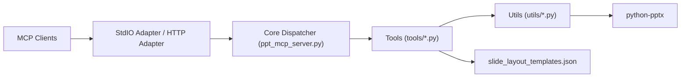

# GongRzhe/Office-PowerPoint-MCP-Server

> Python MCP server for creating and editing PowerPoint files from an AI client.

## The problem
An agent cannot produce or edit a `.pptx` cleanly without custom code.

## What it actually does
Exposes 32 to 34 MCP tools (the README is inconsistent on the count) built on python-pptx: presentations, slides, text, images (Pillow), shapes, tables, charts, themes, hyperlinks, connectors, transitions, text extraction. Provides 25 slide templates and 4 palettes. stdio or HTTP transport; Docker possible.

## How it is wired


## Trying it
```bash
python setup_mcp.py
pip install -r requirements.txt
python ppt_mcp_server.py
python ppt_mcp_server.py --transport http --port 8000
docker build -t ppt_mcp_server .
```

## Cost and gotchas
Free, Python and pip. The repository is archived (read-only): no fixes to expect. The README claims Python 3.6+ but nothing checks it.

## What it is not
Not a guaranteed "designer" deck generator: the layout remains that of python-pptx and the supplied templates. The project is no longer evolving.

## Alternatives
No alternative named in the README.

## For you
Ignore: archived and single-maintainer; for AI-driven PowerPoint, better to use python-pptx directly or a maintained server.
