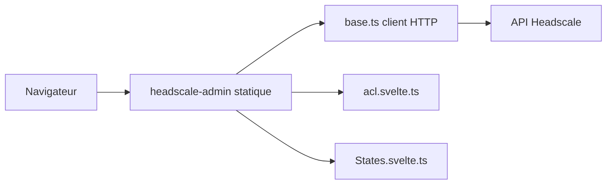

# GoodiesHQ/headscale-admin

> Static web interface to administer a Headscale server (self-hosted Tailscale).

## The problem
Managing Headscale users, nodes, routes and ACLs from the command line alone is tedious.

## What it actually does
Static SvelteKit application: the API URL and key are kept in the browser (LocalStorage), and calls go from the browser to Headscale. Pages: users and pre-auth keys, nodes, routes, a `tailscale up` command builder, an ACL editor (groups, hosts, policies, SSH) that requires `database` mode.

## How it is wired


## Trying it
```bash
docker run -p 8000:80 goodieshq/headscale-admin:latest
headscale apikey create
docker exec headscale headscale apikey create
```

## Cost and gotchas
Free. Version must match Headscale's major version; CORS must be allowed if domains differ; security rests on protecting the API key.

## What it is not
Not a server: without Headscale, it is useless. No sessions or authentication of its own.

## Alternatives
No alternative named in the README.

## For you
Worth watching: handy if you operate Headscale to link your GPU machines or servers, otherwise irrelevant.
