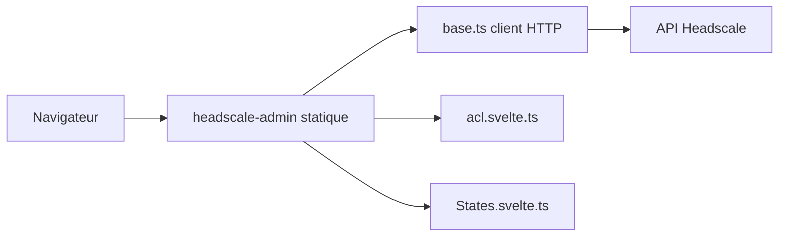

# GoodiesHQ/headscale-admin

> Interface web statique pour administrer un serveur Headscale (Tailscale auto-hébergé).

## Le problème
Gérer utilisateurs, nœuds, routes et ACL de Headscale uniquement en ligne de commande est fastidieux.

## Ce que ça fait vraiment
Application SvelteKit statique : l'URL de l'API et la clé sont conservées dans le navigateur (LocalStorage), les appels vont du navigateur vers Headscale. Pages : utilisateurs et clés de pré-authentification, nœuds, routes, constructeur de commande `tailscale up`, éditeur d'ACL (groupes, hôtes, politiques, SSH) qui exige le mode `database`.

## Comment c'est branché


## Essayer
```bash
docker run -p 8000:80 goodieshq/headscale-admin:latest
headscale apikey create
docker exec headscale headscale apikey create
```

## Coût et pièges
Gratuit. Version à aligner sur la version majeure de Headscale ; CORS à autoriser si domaines différents ; la sécurité repose sur la protection de la clé d'API.

## Ce que ce n'est pas
Pas un serveur : sans Headscale, il ne sert à rien. Pas de sessions ni d'authentification propre.

## Alternatives
Aucune alternative nommée dans le README.

## Pour toi
À surveiller : pratique si tu opères Headscale pour relier tes machines GPU ou serveurs, sinon sans objet.

