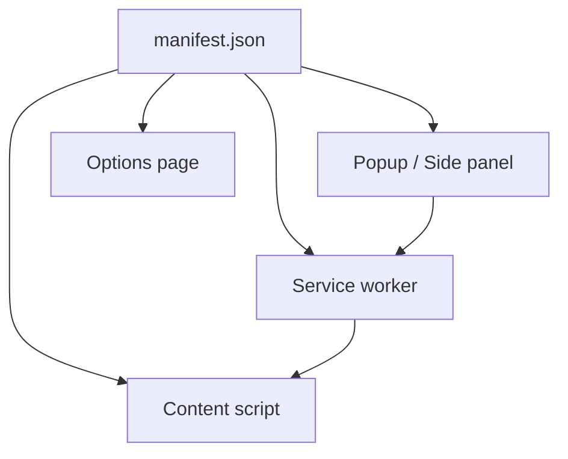

# GoogleChrome/chrome-extensions-samples

> Official Chrome extension samples, one per API or use case, for extension developers.

## The problem
Extension APIs are numerous, and combining them (service worker, content scripts, popup) is hard to guess without an example.

## What it actually does
The repository gathers standalone extensions: `api-samples/` (one API per example), `functional-samples/` (complete multi-API extensions), `_archive/apps/` (deprecated Chrome apps) and `_archive/mv2/` (manifest v2). Each example has its own `manifest.json`, a service worker, and possibly content scripts, a popup or a side panel. A "Samples" page lets you filter by API or permission.

## How it is wired


## Trying it
```bash
git clone <ce dépôt>
```
Then "Load Unpacked Extension" from the browser (README instruction, no command).

## Cost and gotchas
Free. The archived examples (apps, manifest v2) are deprecated.

## What it is not
It is neither a library nor a ready-to-publish template: each example illustrates a specific point.

## Alternatives
The README points to the Chrome Developers documentation.

## For you
Ignore: only useful if you write a browser extension, for example to plug an AI assistant into web pages.
