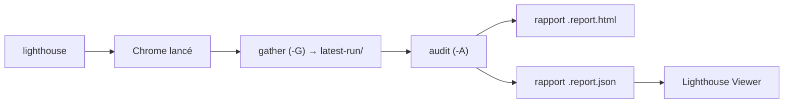

# GoogleChrome/lighthouse

> Automated audit of a web page: performance, accessibility, SEO, best practices.

## The problem
Measuring a page's performance by hand gives non-reproducible numbers.
Without a measured budget in CI, regressions reach production unnoticed.

## What it actually does
Launches Chrome, collects traces, runs audits and produces an HTML, JSON or CSV report.
Three surfaces: DevTools panel, Chrome extension, Node CLI (the most configurable).
The cycle is split: `-G` gathers artifacts to disk, `-A` replays them as audits outside the browser.
Screen emulation, network/CPU throttling, selectable categories and audits, third-party plugins.

## How it is wired


## Trying it
```bash
npm install -g lighthouse
lighthouse https://airhorner.com/
lighthouse <url> --only-categories=performance,seo
lighthouse <url> --output json --output-path ./report.json --save-assets
lighthouse http://example.com -GA
```

## Cost and gotchas
Free, but requires Node 22+ and an installed Chrome; heavy runs generate large traces.
On first launch, the CLI asks for permission to anonymously send runtime exceptions.

## What it is not
It is not field measurement: it is a lab test, with its documented variance.
It is not a monitor: history and alerts come from third-party services (mostly paid).
The README provided here is truncated after the "related projects" section.

## Alternatives
WebPageTest: measurement on real devices, can produce a Lighthouse report as a complement.
GoogleChrome/lighthouse-ci: the official version for tracking every commit and blocking regressions.
lighthouse-plugin-field-performance: adds real-user metrics from the Chrome UX Report.

## For you
Outside the data/AI scope: useful only if you ship a web interface whose speed matters.
