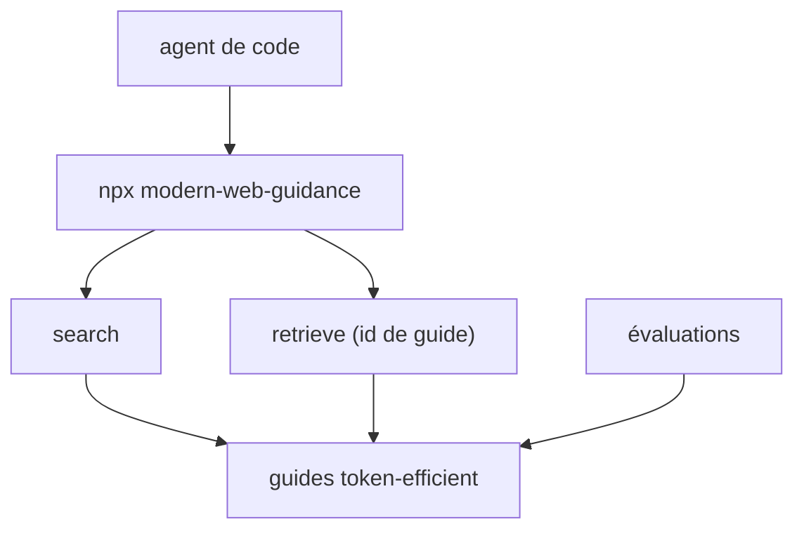

# GoogleChrome/modern-web-guidance-src

> Skills for coding agents that steer them toward modern web APIs instead of legacy code.

## The problem
Coding agents reproduce old patterns learned from their training data, such as heavy JavaScript for tasks that are now native.

## What it actually does
Source repository of a set of guides (240 web features, 193 use cases: CSS, forms, accessibility, performance, passkeys, Temporal, in-browser AI). A command line searches for and retrieves a targeted guide for the agent's context. The repository also contains the authoring, calibration and evaluation code. The README is truncated at the end of the list.

## How it is wired

Simplified diagram based on the sheet, no diagram was provided.

## Trying it
```bash
npx modern-web-guidance@latest install
npx modern-web-guidance@latest search "animate a dialog modal backdrop"
npx modern-web-guidance@latest retrieve "animate-to-from-top-layer"
```

## Cost and gotchas
Free, Node required for npx. Preliminary version. Many open issues (407).

## What it is not
Not a framework. Not proof of gains: the evaluations are described but their results are not in the README.

## Alternatives
No alternative named in the README.

## For you
Worth watching: if you have an agent write front-end code, this kind of on-demand guide saves tokens; otherwise off-topic.
