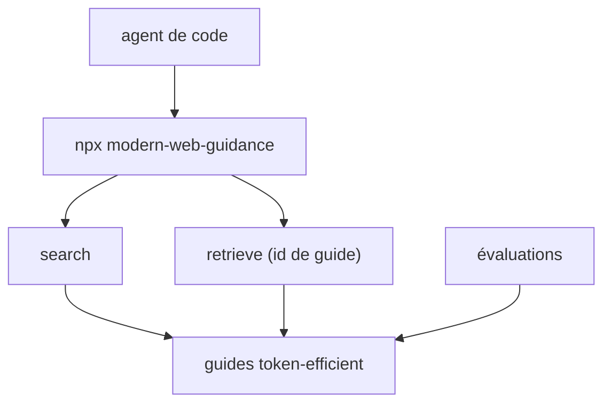

# GoogleChrome/modern-web-guidance-src

> Compétences pour agents de code qui orientent vers les API web modernes plutôt que le code hérité.

## Le problème
Les agents de code reproduisent des motifs anciens appris dans leurs données, comme du JavaScript lourd pour des tâches désormais natives.

## Ce que ça fait vraiment
Dépôt source d'un jeu de guides (240 fonctionnalités web, 193 cas d'usage : CSS, formulaires, accessibilité, performance, passkeys, Temporal, IA embarquée dans le navigateur). Une ligne de commande cherche et récupère un guide ciblé pour le contexte de l'agent. Le dépôt contient aussi le code d'écriture, de calibrage et d'évaluation. Le README est tronqué en fin de liste.

## Comment c'est branché

Schéma simplifié d'après la fiche, sans diagramme fourni.

## Essayer
```bash
npx modern-web-guidance@latest install
npx modern-web-guidance@latest search "animate a dialog modal backdrop"
npx modern-web-guidance@latest retrieve "animate-to-from-top-layer"
```

## Coût et pièges
Gratuit, Node requis pour npx. Version préliminaire. Beaucoup d'issues ouvertes (407).

## Ce que ce n'est pas
Pas un framework. Pas une preuve de gain : les évaluations sont décrites mais leurs résultats ne figurent pas dans le README.

## Alternatives
Aucune alternative nommée dans le README.

## Pour toi
À surveiller : si tu fais coder du front à un agent, ce type de guide à la demande économise des jetons ; sinon hors sujet.

