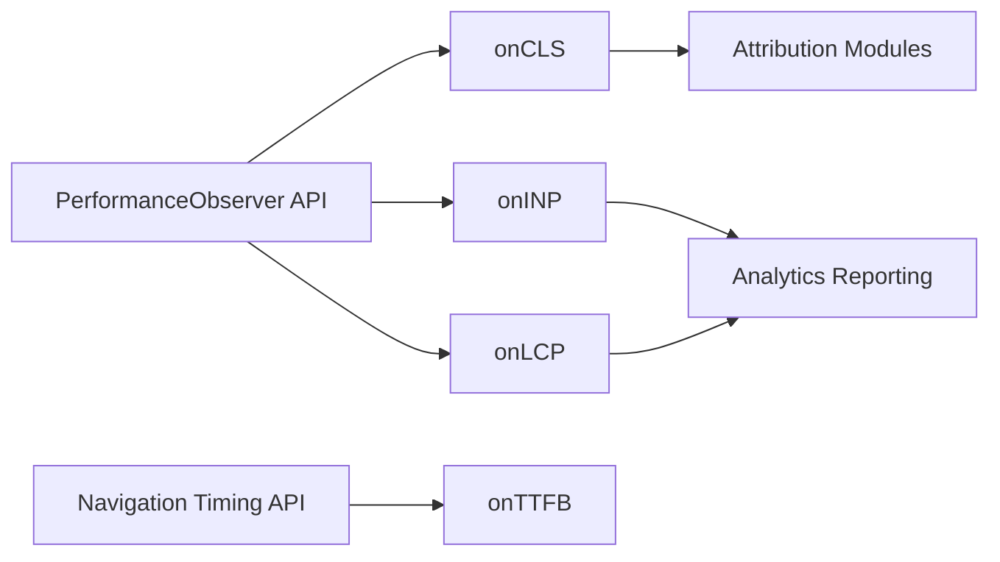

# GoogleChrome/web-vitals

> Small Google JavaScript library that measures Core Web Vitals on real users.

## The problem
Measuring LCP, INP or CLS in the browser exactly as Chrome and Google tools do is tricky with the raw APIs.

## What it actually does
Functions `onCLS`, `onINP`, `onLCP`, `onFCP`, `onTTFB` that call a callback with a `Metric` object (value, delta, rating, id, navigation type). An "attribution" build to find which element or script causes a bad value. Handles the back/forward cache, background pages and, since Chrome 151, SPA "soft" navigations. About 3 KB compressed.

## How it is wired


## Trying it
```bash
npm install web-vitals
npm run build
npm test
```

## Cost and gotchas
Free. Some metrics only report after an interaction or a tab change; calling the functions multiple times increases memory.

## What it is not
Not an analytics tool: it measures, and it is up to you to send to GA4 or your endpoint. Cannot see the content of iframes.

## Alternatives
- web-vitals-reporter: third-party library to batch sends into a single request.

## For you
To ignore for a data/AI profile: a front-end web performance tool, relevant only if you need to collect user metrics for analysis.
