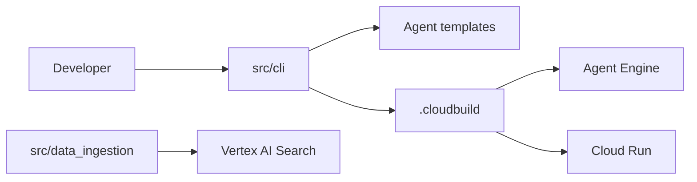

# GoogleCloudPlatform/agent-starter-pack

> GenAI agent templates with infrastructure, CI/CD and observability on Google Cloud, now in maintenance.

## The problem
Going from an agent prototype to a deployment with Terraform, CI/CD and monitoring takes weeks.

## What it actually does
`agent-starter-pack create` generates a project: agent (ADK, ADK A2A, agentic RAG, LangGraph, ADK Java, Live API), frontend, deployment.
Cloud Run or Agent Engine targets, Terraform, Cloud Build or GitHub Actions.
Ingestion pipeline for RAG (Vertex AI Search, Vector Search), Vertex AI evaluation.
`enhance` adds the infrastructure to an existing agent.

## How it is wired


## Trying it
```bash
uvx agent-starter-pack create
pip install --upgrade agent-starter-pack
agent-starter-pack create
uvx agent-starter-pack enhance
uvx google-agents-cli setup
```

## Cost and gotchas
GCP resources billed to your project; Google Cloud SDK, Terraform, Make.
Project in maintenance: critical fixes only.

## What it is not
Not an officially supported Google product (README disclaimer).
Not the right starting point for a new project: migrate to `agents-cli`.

## Alternatives
- agents-cli: successor recommended by the README.
- ADK Samples: more ADK examples.

## For you
Ignore in favor of `agents-cli`: the repo is frozen, useful only if you already have projects generated with it.
