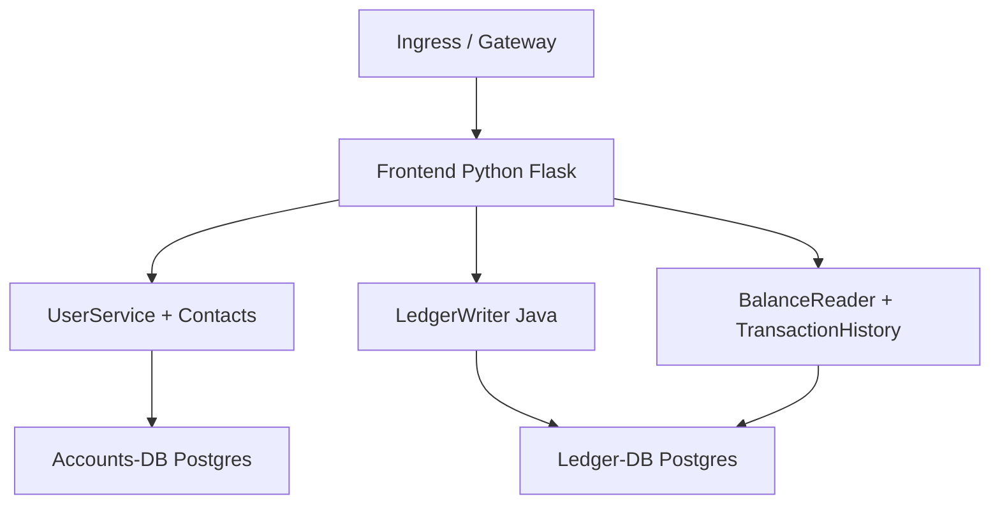

# GoogleCloudPlatform/bank-of-anthos

> Demo banking application built as microservices, which Google uses to showcase GKE, Anthos and Cloud SQL.

## The problem
There is no realistic multi-service application to try out Kubernetes, a service mesh and CI/CD.

## What it actually does
A simulated bank: the Flask (Python) frontend calls `userservice` and `contacts` (Python, accounts-db database) for authentication and contacts, `ledgerwriter` (Java) to write to ledger-db, and `balancereader` and `transactionhistory` (Java) for reads. A Locust load generator sends traffic. Authentication relies on JWT tokens. The application runs on any Kubernetes cluster.

## How it is wired
Based on the provided diagram, simplified.



## Trying it
```sh
git clone https://github.com/GoogleCloudPlatform/bank-of-anthos
cd bank-of-anthos/
kubectl apply -f ./extras/jwt/jwt-secret.yaml
kubectl apply -f ./kubernetes-manifests
kubectl get pods
```

## Cost and gotchas
The quick start creates a GKE Autopilot cluster billed to your Google Cloud project: delete it after use. The README notes that Googlers fill in an internal form.

## What it is not
Not a real banking application: it is a demo with fictitious accounts. There is a Java monolith variant for VMs.

## Alternatives
No alternative named in the README.

## For you
Worth watching: a good testbed for practicing Kubernetes deployment and service mesh in an MLOps context, provided you keep the cluster bill under control.
