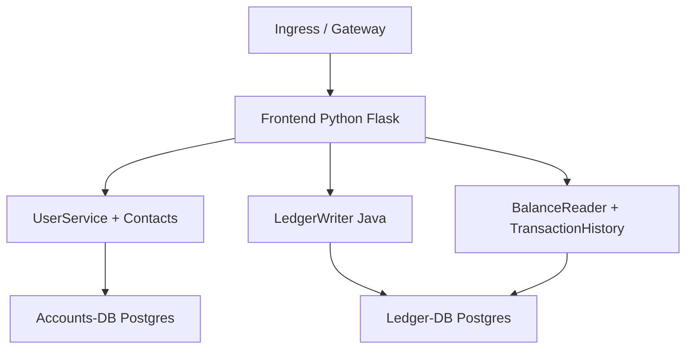

# GoogleCloudPlatform/bank-of-anthos

> Application bancaire de démonstration en microservices, que Google utilise pour montrer GKE, Anthos et Cloud SQL.

## Le problème
Il manque une application réaliste, multi-services, pour essayer Kubernetes, un maillage de services et le CI/CD.

## Ce que ça fait vraiment
Une banque simulée : le frontend Flask (Python) appelle `userservice` et `contacts` (Python, base accounts-db) pour l'authentification et les contacts, `ledgerwriter` (Java) pour écrire dans ledger-db, `balancereader` et `transactionhistory` (Java) pour les lectures. Un générateur de charge Locust envoie du trafic. L'authentification passe par des jetons JWT. L'application tourne sur n'importe quel cluster Kubernetes.

## Comment c'est branché
D'après le diagramme fourni, simplifié.



## Essayer
```sh
git clone https://github.com/GoogleCloudPlatform/bank-of-anthos
cd bank-of-anthos/
kubectl apply -f ./extras/jwt/jwt-secret.yaml
kubectl apply -f ./kubernetes-manifests
kubectl get pods
```

## Coût et pièges
Le démarrage rapide crée un cluster GKE Autopilot facturé sur ton projet Google Cloud : supprime-le après usage. Le README précise que les Googlers remplissent un formulaire interne.

## Ce que ce n'est pas
Pas une vraie application bancaire : c'est une démonstration avec des comptes fictifs. Il y a une variante monolithe Java pour VM.

## Alternatives
Aucune alternative nommée dans le README.

## Pour toi
À surveiller : bon banc d'essai pour pratiquer le déploiement Kubernetes et le maillage de services dans un contexte MLOps, à condition de maîtriser la facture du cluster.

