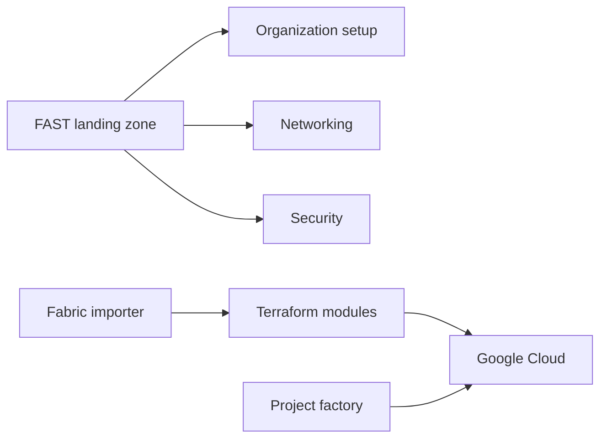

# GoogleCloudPlatform/cloud-foundation-fabric

> Terraform modules and a landing zone template (FAST) for building a Google Cloud organization.

## The problem
Setting up an enterprise-grade GCP organization (projects, network, IAM, security) is slow and poorly standardized.

## What it actually does
Two parts: FAST, a GCP organization design with staged Terraform implementation, and a suite of modules close to the provider's resources (foundations, networking, compute, data, AI, development, security, serverless). The AI modules cover AI Applications and components of the Gemini Enterprise Agent Platform. Added to these are an importer for existing infrastructure and a SecOps anonymization pipeline.

## How it is wired

## Trying it
No command in the README: see each module's README and the contribution guide.

## Cost and gotchas
The code is free but GCP resources are billed. You need a GCP account with organization rights. The repo is designed to be forked and owned.

## What it is not
Not an officially supported product nor a managed service: a kit to fork. It covers Google Cloud only.

## Alternatives
None named in the README (a comparison with other kits is mentioned without names).

## For you
Keep an eye on it: useful as a reference for industrializing a data/AI platform on GCP (projects, network, AI modules), useless elsewhere.
