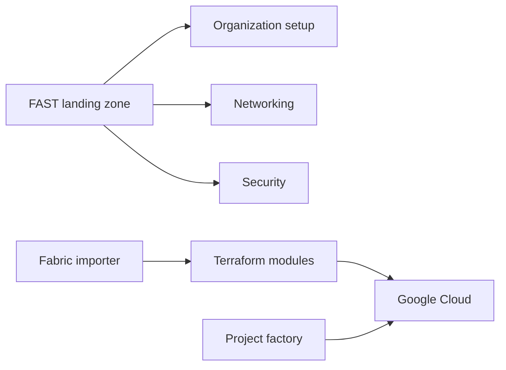

# GoogleCloudPlatform/cloud-foundation-fabric

> Modules Terraform et modèle de zone d'atterrissage (FAST) pour bâtir une organisation Google Cloud.

## Le problème
Monter une organisation GCP de niveau entreprise (projets, réseau, IAM, sécurité) est long et mal standardisé.

## Ce que ça fait vraiment
Deux volets : FAST, conception d'organisation GCP avec implémentation Terraform par étapes, et une suite de modules proches des ressources du fournisseur (fondations, réseau, calcul, données, IA, développement, sécurité, serverless). Les modules d'IA couvrent AI Applications et des composants Gemini Enterprise Agent Platform. S'y ajoutent un importeur d'infrastructure existante et un pipeline d'anonymisation SecOps.

## Comment c'est branché

## Essayer
Aucune commande dans le README : voir le README de chaque module et le guide de contribution.

## Coût et pièges
Le code est gratuit mais les ressources GCP sont facturées. Il faut un compte GCP avec droits d'organisation. Le dépôt est conçu pour être forké et possédé.

## Ce que ce n'est pas
Pas un produit supporté officiellement ni un service géré : un kit à forker. Il n'y a que Google Cloud.

## Alternatives
Aucune nommée dans le README (une comparaison avec d'autres kits est évoquée sans nom).

## Pour toi
Surveiller : utile comme référence pour industrialiser une plateforme data/IA sur GCP (projets, réseau, modules d'IA), inutile ailleurs.

