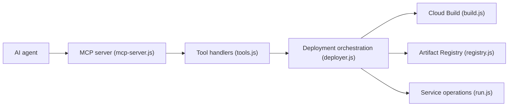

# GoogleCloudPlatform/cloud-run-mcp

> MCP server and Gemini CLI extension that let an agent deploy applications to Cloud Run.

## The problem
Deploying code to Cloud Run from an AI agent requires scripting gcloud by hand.

## What it actually does
Seven MCP tools: deploy file contents, list and read services, read logs, and locally deploy a folder, list or create GCP projects. Two prompts (`deploy`, `logs`). The code orchestrates Cloud Build, Artifact Registry and Cloud Storage, with an optional OAuth mode. "Cloud Run Skills" on gcloud are also provided.

## How it is wired


## Trying it
```bash
gcloud auth login
gcloud auth application-default login
gemini extensions install https://github.com/GoogleCloudPlatform/cloud-run-mcp
```
MCP configuration: `"command": "npx", "args": ["-y", "@google-cloud/cloud-run-mcp"]`.

## Cost and gotchas
Google Cloud account and application credentials; deployments and project creation (attached to the first billing account) put charges on your bill. The remote server must never be exposed without IAM authentication.

## What it is not
The Google Cloud terms and the data processing agreement do not apply to any component of the software, according to the README. Not an MLOps platform.

## Alternatives
No alternative cited in the README; the "Cloud Run Skills" (in the same repository) go directly through gcloud.

## For you
Worth watching if you deploy on Cloud Run: it saves scripts, but gives the agent the right to create projects and deployments, so it needs to be bounded.
