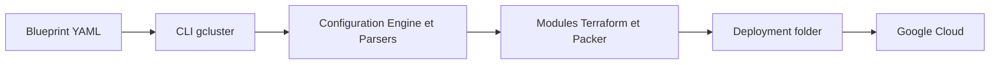

# GoogleCloudPlatform/cluster-toolkit

> Google tool that deploys AI and high-performance computing clusters on Google Cloud from YAML blueprints.

## The problem
Setting up a GPU or Slurm cluster with RDMA networking, storage and scheduling takes hundreds of lines of Terraform and tuning.

## What it actually does
The `gcluster` binary reads a YAML blueprint, validates it, generates a Terraform or Packer deployment folder, then deploys it in stages. Modules are linked via `use:`. It targets Slurm and GKE with GPUs and TPUs, and a `gcluster job submit` command sends JobSets to GKE (ready-made image or built on the fly).

## How it is wired


## Trying it
```bash
./gcluster deploy examples/hpc-slurm.yaml --vars project_id=<PROJECT_ID>
./gcluster destroy hpc-slurm
```

## Cost and gotchas
A Google Cloud project with APIs enabled and high quotas; GPU or TPU resources are billed. Terraform and Packer are required (downloaded with `--download-dependencies`). Usage telemetry is sent to Google, can be turned off with `./gcluster telemetry off`. The README advises against service account JSON keys.

## What it is not
Not a training scheduler: it builds the infrastructure. No Windows pre-build.

## Alternatives
The README names no alternative.

## For you
Keep an eye on it: relevant if you build training clusters on Google Cloud, otherwise keep it in reserve.
