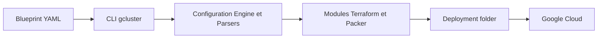

# GoogleCloudPlatform/cluster-toolkit

> Outil Google qui déploie des clusters IA et calcul haute performance sur Google Cloud à partir de plans YAML.

## Le problème
Monter un cluster GPU ou Slurm avec réseaux RDMA, stockage et planification demande des centaines de lignes de Terraform et de réglages.

## Ce que ça fait vraiment
Le binaire `gcluster` lit un plan (« blueprint ») YAML, le valide, génère un dossier de déploiement Terraform ou Packer, puis le déploie par étapes. Les modules sont reliés via `use:`. Il vise Slurm et GKE avec GPU et TPU, et une commande `gcluster job submit` envoie des JobSets sur GKE (image prête ou construite à la volée).

## Comment c'est branché


## Essayer
```bash
./gcluster deploy examples/hpc-slurm.yaml --vars project_id=<PROJECT_ID>
./gcluster destroy hpc-slurm
```

## Coût et pièges
Projet Google Cloud avec APIs activées et quotas élevés, ressources GPU ou TPU facturées. Terraform et Packer requis (téléchargés avec `--download-dependencies`). Télémétrie d'usage envoyée à Google, désactivable avec `./gcluster telemetry off`. Le README déconseille les clés JSON de compte de service.

## Ce que ce n'est pas
Pas un ordonnanceur d'entraînement : il construit l'infrastructure. Pas de pré-build Windows.

## Alternatives
Le README ne nomme pas d'alternative.

## Pour toi
Surveiller : pertinent si tu montes des clusters d'entraînement sur Google Cloud, à garder en réserve sinon.

