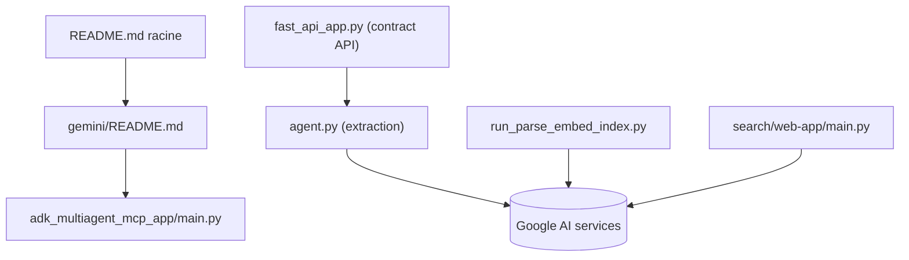

# GoogleCloudPlatform/generative-ai

> Notebooks and sample applications for using Gemini and generative AI on Google Cloud.

## The problem
Getting started with Gemini, search, RAG or agents on Google Cloud requires finding reliable, up-to-date examples.

## What it actually does
A repository of demonstrations, not a product: notebooks (`gemini/getting-started/`), ADK agents (`agents/adk/`), search examples (`search/`), FastAPI apps with LlamaIndex RAG, LiveKit bridge, Terraform and Docker Compose for some examples. Each folder is self-contained, with no common runtime.

## How it is wired


## Trying it
```bash
# Le README fourni ne contient aucune commande : ouvrir les notebooks, par exemple
# gemini/getting-started/intro_gemini_3_6_flash.ipynb
```

## Cost and gotchas
The examples call managed Google Cloud services: account and billing are on you. The README specifies that the code is "for demonstrative purposes only".

## What it is not
Not a framework nor a library, not an officially supported product (stated in the README). The examples are not meant for production as is.

## Alternatives
- Gemini Cookbook: another collection of examples around Gemini.
- Vertex AI Samples: broader examples on Vertex AI.
- ADK Samples: ready-to-use agents on the Agent Development Kit.

## For you
Watch: good reference material if you work on Google Cloud, of little use outside that ecosystem.
