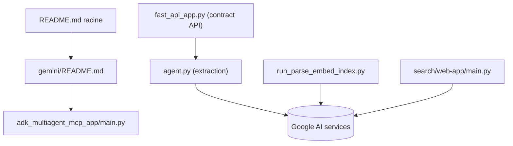

# GoogleCloudPlatform/generative-ai

> Notebooks et exemples d'applications pour utiliser Gemini et l'IA générative sur Google Cloud.

## Le problème
Démarrer avec Gemini, la recherche, le RAG ou les agents sur Google Cloud demande de trouver des exemples fiables et à jour.

## Ce que ça fait vraiment
Un dépôt de démonstrations, pas un produit : notebooks (`gemini/getting-started/`), agents ADK (`agents/adk/`), exemples de recherche (`search/`), applis FastAPI avec RAG LlamaIndex, bridge LiveKit, Terraform et Docker Compose pour certains exemples. Chaque dossier est autonome, sans runtime commun.

## Comment c'est branché


## Essayer
```bash
# Le README fourni ne contient aucune commande : ouvrir les notebooks, par exemple
# gemini/getting-started/intro_gemini_3_6_flash.ipynb
```

## Coût et pièges
Les exemples appellent des services managés Google Cloud : compte et facturation à ta charge. Le README précise que le code est « for demonstrative purposes only ».

## Ce que ce n'est pas
Pas un framework ni une bibliothèque, pas un produit officiellement supporté (dit dans le README). Les exemples ne sont pas faits pour la production telle quelle.

## Alternatives
- Gemini Cookbook : autre recueil d'exemples autour de Gemini.
- Vertex AI Samples : exemples plus larges sur Vertex AI.
- ADK Samples : agents prêts à l'emploi sur l'Agent Development Kit.

## Pour toi
Surveiller : bon fonds de référence si tu travailles sur Google Cloud, peu utile hors de cet écosystème.

