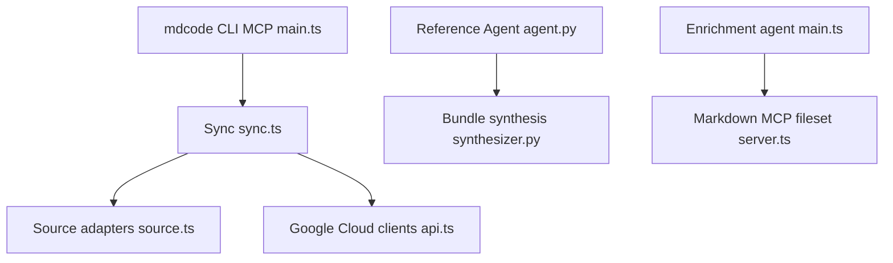

# GoogleCloudPlatform/knowledge-catalog

> Tools, agents and examples around Google Cloud Knowledge Catalog (formerly Dataplex), for data teams on GCP.

## The problem
AI agents lack business semantics on data. Documenting tables by hand does not keep up.

## What it actually does
The README is minimal (a few lines). From the described architecture: the `mdcode` tool syncs metadata as Markdown files with the catalog and deploys semantic models (BigQuery, Spanner). A reference Python agent generates Markdown bundles from BigQuery and the web. A TypeScript enrichment agent completes the documentation.

## How it is wired

## Trying it
No command documented in the provided README. The Python entry point is `okf/src/reference_agent/__main__.py`; exact usage is not documented.

## Cost and gotchas
Assumes a Google Cloud project (Knowledge Catalog, BigQuery, Gemini): calls are billed to you. README not usable on its own.

## What it is not
Not an official Google product (the README says so). Not a ready-to-use data catalog: a multi-language examples repository (TypeScript and Python).

## Alternatives
No alternative named in the README.

## For you
Keep an eye on it if you are on GCP and want metadata-as-code for agents; README nearly empty, so evaluate the code before committing.
