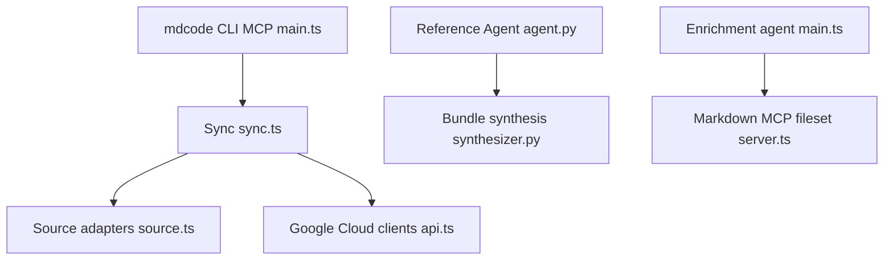

# GoogleCloudPlatform/knowledge-catalog

> Outils, agents et exemples autour de Google Cloud Knowledge Catalog (ex-Dataplex), pour équipes données sur GCP.

## Le problème
Les agents IA manquent de sémantique métier sur les données. Documenter les tables à la main ne suit pas.

## Ce que ça fait vraiment
Le README est minimal (quelques lignes). D'après l'architecture décrite : l'outil `mdcode` synchronise des métadonnées sous forme de fichiers Markdown avec le catalogue et déploie des modèles sémantiques (BigQuery, Spanner). Un agent Python de référence génère des bundles Markdown depuis BigQuery et le web. Un agent d'enrichissement TypeScript complète la documentation.

## Comment c'est branché

## Essayer
Aucune commande documentée dans le README fourni. Le point d'entrée Python est `okf/src/reference_agent/__main__.py` ; l'usage exact n'est pas documenté.

## Coût et pièges
Suppose un projet Google Cloud (Knowledge Catalog, BigQuery, Gemini) : appels facturés à ta charge. README non exploitable seul.

## Ce que ce n'est pas
Pas un produit Google officiel (le README le dit). Pas un catalogue de données prêt à l'emploi : un dépôt d'exemples multi-langages (TypeScript et Python).

## Alternatives
Aucune alternative nommée dans le README.

## Pour toi
À surveiller si tu es sur GCP et veux de la métadonnée-as-code pour agents ; README quasi vide, donc évalue le code avant de t'y engager.

