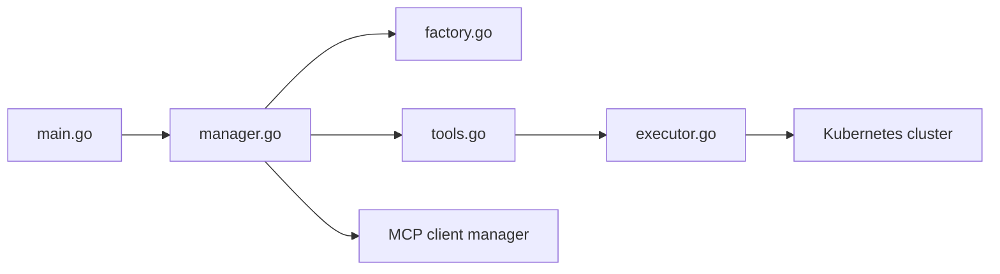

# GoogleCloudPlatform/kubectl-ai

> CLI agent that translates natural-language requests into kubectl operations.

## The problem
Diagnosing a cluster requires knowing kubectl by heart and chaining commands by hand.

## What it actually does
An agent loop: the LLM calls the `kubectl` and `bash` tools, with confirmation before any modification.
Gemini, Vertex, OpenAI, Azure, Grok, Bedrock, Ollama, llama.cpp through the `gollm` abstraction.
MCP client (external tools) and MCP server (exposes kubectl), over stdio or HTTP with optional OAuth.
Persistent sessions, terminal or web UI, custom tools in YAML.

## How it is wired


## Trying it
```bash
curl -sSL https://raw.githubusercontent.com/GoogleCloudPlatform/kubectl-ai/main/install.sh | bash
export GEMINI_API_KEY=your_api_key_here
kubectl-ai --quiet "fetch logs for nginx app in hello namespace"
```

## Cost and gotchas
LLM key at your expense, kubeconfig required. In HTTP MCP server mode without OAuth, anyone who can reach the port can run kubectl and bash.

## What it is not
Not an officially supported Google product (stated outright in the README).

## Alternatives
No alternative named in the README.

## For you
Worth watching: handy for debugging inference pods without mastering kubectl, as long as you keep action confirmation enabled.
