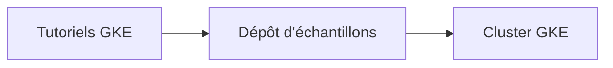

# GoogleCloudPlatform/kubernetes-engine-samples

> Sample applications used in the official Google Kubernetes Engine tutorials.

## The problem
Following the GKE tutorials requires ready-made sample applications, versioned and consistent with the documentation.

## What it actually does
The repository gathers the samples referenced by the GKE guides and quickstart. The README does not detail their content: it points to the Google documentation and to an interactive demo.

## How it is wired
Simplified diagram based on the sheet, no diagram provided.

## Trying it
No command documented in the README: it points to the GKE guides and quickstart.

## Cost and gotchas
A Google Cloud account is needed to deploy on GKE, with billing for resources. The repository itself is under Apache-2.0.

## What it is not
Not a complete application or a tool to install: these are examples tied to tutorials.

## Alternatives
No alternative named in the README.

## For you
Worth watching: useful as a starting point if you deploy AI workloads on GKE, but the README alone does not say which samples exist.
